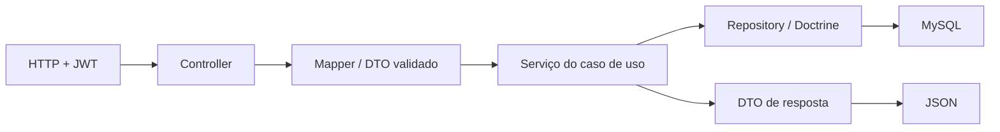

# Arquitetura e decisões

## Fluxo e responsabilidades

Controllers fazem a fronteira HTTP: usuário autenticado, parsing, código/status e cabeçalhos. Mappers rejeitam JSON/tipos/campos inválidos antes de construir DTOs. Serviços recebem dados explícitos, não Request, e não devolvem JsonResponse. Entidades representam tarefa/proprietário/datas; repositories concentram as consultas. Respostas usam DTOs explícitos, sem serializar relações Doctrine.

Os casos de uso são pequenos e separados: cadastro, login, criação, listagem, busca própria, edição e exclusão. Repository, DTO e serviços de aplicação têm funções concretas. A única interface própria de consulta é TaskListQuery, necessária para envolver a implementação SQL com CachedTaskList. Não há repositório genérico adicional sobre o Doctrine.

## Autenticação e isolamento

JWT RS256 com TTL configurável e provider de usuário no banco a cada requisição. Senha com hash do Symfony, username normalizado e unicidade no MySQL, incluindo tratamento de conflito entre cadastros concorrentes. API stateless e CORS restrito às origens configuradas, sem cookies.

Todas as consultas de tarefas incluem o proprietário. Na edição, a tarefa é localizada antes de ler o corpo. Outro proprietário e ID inválido/inexistente devolvem o mesmo 404. Owner, ID e datas são imutáveis pela API. O erro tem formato único e request ID; no-store é preservado inclusive com cache interno.

## Consultas e cache

Paginação limitada a 100 itens; ordenação createdAt DESC/id DESC, com desempate determinístico. O índice composto foi observado no EXPLAIN sem filesort. O índice simples do proprietário foi mantido porque o COUNT o utilizou como índice de cobertura. OFFSET custa mais em páginas profundas; não foi demonstrado um limite de usuários/requisições concorrentes.

CachedTaskList é um Decorator de TaskListQuery. Cacheia DTOs de listagem por proprietário/geração/página/limite/ordenação, por 30 s. Não cacheia JWT, usuário nem GET por ID. Cada mutação avança uma geração aleatória na linha do proprietário, no mesmo commit da tarefa; a autenticação já lê essa geração. Isso invalida todas as páginas sem exigir DEL no Redis depois do commit.

Uma leitura iniciada antes de uma alteração pode terminar com dados anteriores, mas não consegue preencher a geração nova com o snapshot antigo. O teste controla essa intercalação com banco/cache reais. Indisponibilidade e recuperação, inclusive com entradas antigas retidas, estão cobertas. As chaves antigas expiram; Redis tem memória limitada e pode descartar entradas sem afetar o banco.

Cache frio tem custo adicional; cache quente evita as duas consultas de tarefas, mantendo a consulta de autenticação. Há um UPDATE extra por mutação e disputa possível entre escritas do mesmo proprietário. Não há lock distribuído para preenchimento nem prova de capacidade sob carga. Método e resultados estão em [FASE_4.md](FASE_4.md).

## Contrato, concorrência e testes

[OpenAPI](openapi.yaml) é a fonte do contrato 0.1.0. PUT substitui título/descrição; edições seguem last-write-wins, sem optimistic locking. Listagem/COUNT não são um snapshot atômico entre alterações concorrentes. Datas UTC têm precisão de segundos.

PHPUnit combina testes unitários, integração MySQL/Redis e HTTP real do kernel. O middleware de contagem SQL existe só no ambiente de testes. O benchmark usa fixture em transação, rollback e namespace Redis exclusivo. O frontend valida o fluxo por Chromium com API/banco/cache temporários.

A reprodução usa Docker e lockfile. As duas migrations criam o schema do zero e atualizam uma instalação existente. Chaves, dependências, logs e variáveis locais ficam fora do Git. Os defaults de credenciais/APP_SECRET são de desenvolvimento; a documentação não apresenta esse Compose como implantação de produção.

## Compatibilidade e escopo

PHP 8.1 e Symfony 6.4, mantendo o major 6 resolvido pelo skeleton. O frontend está em [GuilhermeBenites/agu-angular](https://github.com/GuilhermeBenites/agu-angular); a API é acessada por URL, sem dependência de diretório irmão.

Redis foi o opcional escolhido. Exportação/RabbitMQ, busca externa, tempo real, X.509 e conclusão de tarefa ficaram fora do contrato acordado. A solução mantém um monólito modular, sem processos/camadas extras sem uso demonstrado.
